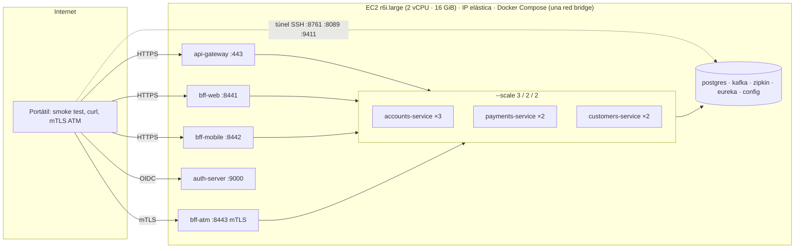
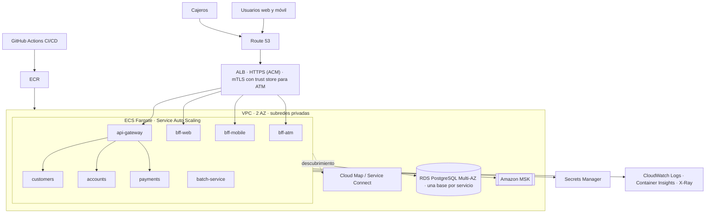

# Despliegue en AWS — Banco XYZ

Este documento tiene **tres partes**: (A) el despliegue **real y mínimo** en una instancia EC2 de AWS Academy Learner Lab con Docker Compose, con escalado
horizontal de contenedores; (B) la **arquitectura objetivo** productiva (ECS Fargate + ALB + RDS + MSK), solo documentada;
y (C) las **limitaciones** del despliegue mínimo, declaradas con honestidad.

> **Quién ejecuta qué.** Todo lo que toca AWS lo ejecuta la persona que despliega con su propia cuenta. Los scripts y los comandos de este
> documento están listos y los valores reales de la ejecución realizada (instancia, zona, IP elástica, tiempos y memoria) están escritos en
> [Despliegue realizado](#despliegue-realizado-2026-10-11). En la Parte B (arquitectura objetivo, solo conceptual) los valores que dependen de
> una cuenta productiva se muestran como ejemplo con la forma `<ARN del certificado ACM>`.
>
> **Probado antes de desplegar.** El flujo `deploy.sh` → `verify.sh` → `smoke-test.sh --host` se probó en una copia limpia del repositorio (sin `.env`,
> sin certificados, sin caché) y repitiéndolo dentro de un contenedor `docker:dind` limitado a **2 vCPU y 16 GiB sin swap**; `user-data.sh` se ejecutó dos veces
> (idempotencia) dentro de una imagen oficial `amazonlinux:2023`. Lo que solo podía probarse en la cuenta real (cloud-init, Security Group, acceso desde internet,
> IP elástica y `docker compose build` en la instancia) se comprobó en el despliegue real, que además reveló dos diferencias respecto de la simulación (ver A.15).

Índice: [A.1 Prerrequisitos y límites de Learner Lab](#a1-prerrequisitos-y-límites-de-learner-lab) · [A.2 Preparar la sesión](#a2-paso-0--preparar-la-sesión) · [A.3 Tipo de instancia](#a3-paso-1--verificar-qué-tipo-de-instancia-permite-el-lab) ·
[A.4 Red y Security Group](#a4-paso-2--red-y-security-group) · [A.5 Lanzar e IP elástica](#a5-paso-3--lanzar-la-instancia-y-fijar-la-ip-elástica) · [A.6 Bootstrap](#a6-paso-4--esperar-el-bootstrap-user-datash) ·
[A.7 Subir y desplegar](#a7-paso-5--subir-y-desplegar) · [A.8 Verificar](#a8-paso-6--verificar) · [A.9 Escalado horizontal](#a9-escalado-horizontal-en-la-nube) · [A.10 Monitoreo](#a10-monitoreo-y-túnel-ssh) ·
[A.11 Evidencias](#a11-evidencias-a-capturar) · [A.12 Sesión expirada](#a12-si-la-sesión-del-lab-expira-a-mitad-de-camino) · [A.13 Costos y limpieza](#a13-costos-y-limpieza) · [A.15 Problemas frecuentes](#a15-problemas-frecuentes) ·
[Parte B](#parte-b--arquitectura-objetivo-productiva-conceptual) · [Parte C](#parte-c--limitaciones-conocidas-del-despliegue-mínimo)

---

# Parte A — Despliegue realizado: EC2 + Docker Compose en AWS Academy Learner Lab



## Despliegue realizado (2026-10-11)

| Dato | Valor |
|---|---|
| Región / zona | `us-east-1` / `us-east-1a` |
| Instancia | `i-06f6ae68fbb6c00ea`, tipo **`r6i.large`** (2 vCPU, 16 GiB), Amazon Linux 2023 (`ami-0d27e0fb3bac4d724`), 30 GB gp3 |
| IP elástica | `34.207.23.142` |
| Security Group | `banco-xyz-apps-sg` (`sg-0f975e250af0df5ec`): 22, 8443 y 9000 solo desde la IP de quien opera; 443 y 8441–8442 públicos |
| Contenedores | 19 en ejecución, 18 *healthy* (Kafka UI no define *healthcheck*); accounts ×3, payments ×2, customers ×2 |
| Memoria real (`docker stats`, sin swap) | 5.347 MiB en contenedores; host con 5,8 GiB usados y 9,2 GiB disponibles de 15 GiB |
| Smoke test remoto (sin `--insecure`) | 77 verificaciones correctas, 0 fallidas |
| Caída de una réplica de `accounts-service` | 40 de 40 peticiones inmediatas correctas (10 POST con HTTP 201) |
| mTLS del ATM | sin certificado: handshake rechazado (`curl` código 56); con certificado y token móvil: HTTP 403 |

Evidencias: las capturas de esta ejecución están en el informe técnico (entrega por separado); `verify.sh` y `smoke-test.sh` dejan sus logs en `evidencias/aws/logs/` (carpeta que no se versiona). El ID de cuenta de AWS no se publica.

## A.1 Prerrequisitos y límites de Learner Lab

- **AWS Academy Learner Lab.** Región `us-east-1`; key pair `vockey`; instance profile `LabInstanceProfile`. **No se pueden crear roles IAM** y la sesión dura unas 4 horas con **credenciales temporales** (cambian en cada *Start Lab*).
- **Solo se permiten instancias de tamaño `large` o menor** (y hasta 9 concurrentes). El diseño original (t3.xlarge, 4 vCPU) **no está permitido**: ver [ADR-010](docs/adr/ADR-010-ajuste-learner-lab.md). Se verificó con `aws ec2 run-instances --dry-run` (Paso 1) y el resultado fue el **Plan A**: un tipo con **2 vCPU y 16 GiB** (`r6i.large`, o `r5.large`), de modo que se mantiene **un solo host** y el presupuesto de memoria de 16 GiB.
- En el portátil: AWS CLI v2, `ssh`, `scp`, `rsync`, `curl`, `openssl`, `python3`, JDK 21 (para `keytool`) y el repositorio con su `.env` (`scripts/init-env.sh`).
- Todo se ejecuta **desde el portátil, en la raíz del repositorio**, en una sola terminal. Las variables se guardan en `infra/aws/.deploy-state` (ignorado por git) para retomar en otra terminal con `source infra/aws/.deploy-state`.

## A.2 Paso 0 — Preparar la sesión

1. En Learner Lab: **Start Lab** y esperar el indicador verde.
2. **AWS Details → AWS CLI → Show**: copiar el bloque en `~/.aws/credentials` bajo el perfil `[learnerlab]` (hay que repetirlo en cada sesión).
3. **AWS Details → Download PEM** (key pair `vockey`): `mv ~/Downloads/labsuser.pem ~/.ssh/labsuser.pem && chmod 400 ~/.ssh/labsuser.pem`.
4. Variables base:

```bash
export AWS_PROFILE=learnerlab AWS_REGION=us-east-1 AWS_PAGER=""
aws sts get-caller-identity --query Arn --output text          # debe contener "voclabs"
STATE=infra/aws/.deploy-state; : > "$STATE"
MY_IP="$(curl -s https://checkip.amazonaws.com)/32"; echo "MY_IP=$MY_IP" >> "$STATE"
SSH_KEY=~/.ssh/labsuser.pem; echo "SSH_KEY=$SSH_KEY" >> "$STATE"
TAGS='{Key=Project,Value=banco-xyz-eft},{Key=Owner,Value=JuanPablo}'
```

## A.3 Paso 1 — Verificar qué tipo de instancia permite el lab

```bash
AMI_ID=$(aws ssm get-parameter --name /aws/service/ami-amazon-linux-latest/al2023-ami-kernel-default-x86_64 \
  --query Parameter.Value --output text 2>/dev/null) || \
AMI_ID=$(aws ec2 describe-images --owners amazon \
  --filters "Name=name,Values=al2023-ami-2023*-kernel-*-x86_64" "Name=state,Values=available" \
  --query 'sort_by(Images,&CreationDate)[-1].ImageId' --output text)
echo "AMI_ID=$AMI_ID" | tee -a "$STATE"

for t in r6i.large r5.large m5.large t3.large; do
  out=$(aws ec2 run-instances --dry-run --image-id "$AMI_ID" --instance-type "$t" --key-name vockey 2>&1)
  if echo "$out" | grep -q DryRunOperation; then echo "$t: PERMITIDO"; else echo "$t: NO"; fi
done
INSTANCE_TYPE=r6i.large; echo "INSTANCE_TYPE=$INSTANCE_TYPE" >> "$STATE"     # o r5.large: ambos tienen 2 vCPU y 16 GiB
```

`--dry-run` no crea nada: responde `DryRunOperation` si la llamada habría sido autorizada. **Resultado de esta entrega: Plan A** (un tipo de 16 GiB está permitido). Si en su sesión solo estuvieran permitidos `t3.large` o `m5.large` (8 GiB), el diseño de dos hosts está descrito como contingencia en el ADR-010.

## A.4 Paso 2 — Red y Security Group

Se usa la **VPC por defecto** y un único Security Group `banco-xyz-apps-sg` con **solo** estas reglas de entrada:

| Puerto | Origen | Para qué | Justificación |
|---|---|---|---|
| 22/tcp | mi IP | SSH y túneles | La administración nunca queda abierta a internet |
| 443/tcp | `0.0.0.0/0` | API Gateway (HTTPS) | Único punto de entrada público a los microservicios |
| 8441–8442/tcp | `0.0.0.0/0` | BFF web y BFF móvil (HTTPS) | Los clientes web y móvil los consumen directo; cada BFF valida su propio canal |
| 8443/tcp | mi IP (la "red de cajeros" de la demo) | BFF ATM con **mTLS** | Los cajeros están en una red conocida; además exigen certificado de cliente |
| 9000/tcp | mi IP | Auth server (OIDC, **HTTP**) | Sin dominio no hay certificado ACM: se limita al origen que pide tokens. Ver limitación C.3 |

Todo lo demás (Eureka, Kafka UI, Zipkin, Grafana, PostgreSQL, Kafka y los microservicios) **no tiene regla de entrada**: las herramientas escuchan solo en `127.0.0.1` de la instancia y se ven por **túnel SSH**.

```bash
VPC_ID=$(aws ec2 describe-vpcs --filters Name=is-default,Values=true --query 'Vpcs[0].VpcId' --output text)
AZ=$(aws ec2 describe-instance-type-offerings --location-type availability-zone \
  --filters Name=instance-type,Values=$INSTANCE_TYPE --query 'sort(InstanceTypeOfferings[].Location)[0]' --output text)   # zona donde existe el tipo (r6i.large NO está en us-east-1e)
SUBNET_ID=$(aws ec2 describe-subnets --filters Name=vpc-id,Values=$VPC_ID Name=default-for-az,Values=true Name=availability-zone,Values=$AZ \
  --query 'Subnets[0].SubnetId' --output text)
printf 'VPC_ID=%s\nSUBNET_ID=%s\n' "$VPC_ID" "$SUBNET_ID" >> "$STATE"

SG_APPS=$(aws ec2 create-security-group --group-name banco-xyz-apps-sg --description "Banco XYZ EFT - gateway, BFF y auth" \
  --vpc-id "$VPC_ID" --tag-specifications "ResourceType=security-group,Tags=[$TAGS]" --query GroupId --output text)
echo "SG_APPS=$SG_APPS" >> "$STATE"

aws ec2 authorize-security-group-ingress --group-id $SG_APPS --protocol tcp --port 22        --cidr "$MY_IP"     # SSH: solo yo
aws ec2 authorize-security-group-ingress --group-id $SG_APPS --protocol tcp --port 443       --cidr 0.0.0.0/0    # gateway
aws ec2 authorize-security-group-ingress --group-id $SG_APPS --protocol tcp --port 8441-8442 --cidr 0.0.0.0/0    # BFF web y móvil
aws ec2 authorize-security-group-ingress --group-id $SG_APPS --protocol tcp --port 8443      --cidr "$MY_IP"     # ATM mTLS
aws ec2 authorize-security-group-ingress --group-id $SG_APPS --protocol tcp --port 9000      --cidr "$MY_IP"     # auth-server (HTTP)
```

## A.5 Paso 3 — Lanzar la instancia y fijar la IP elástica

Volumen raíz **30 GB gp3**, Amazon Linux 2023, perfil `LabInstanceProfile`, `user-data.sh` como *bootstrap*:

```bash
APPS_ID=$(aws ec2 run-instances --image-id "$AMI_ID" --instance-type "$INSTANCE_TYPE" \
  --key-name vockey --iam-instance-profile Name=LabInstanceProfile \
  --subnet-id "$SUBNET_ID" --security-group-ids "$SG_APPS" --associate-public-ip-address \
  --block-device-mappings 'DeviceName=/dev/xvda,Ebs={VolumeSize=30,VolumeType=gp3,DeleteOnTermination=true}' \
  --metadata-options 'HttpTokens=required,HttpEndpoint=enabled' \
  --user-data file://infra/aws/ec2/user-data.sh \
  --tag-specifications "ResourceType=instance,Tags=[{Key=Name,Value=banco-xyz-apps},{Key=Role,Value=apps},$TAGS]" \
  --query 'Instances[0].InstanceId' --output text)
echo "APPS_ID=$APPS_ID" >> "$STATE"
aws ec2 wait instance-status-ok --instance-ids $APPS_ID          # tarda unos minutos

# IP ELÁSTICA: no cambia cuando el lab detiene la instancia al expirar la sesión, así que el certificado con la IP en el SAN sigue siendo válido
ALLOC_ID=$(aws ec2 allocate-address --domain vpc --tag-specifications "ResourceType=elastic-ip,Tags=[$TAGS]" --query AllocationId --output text)
aws ec2 associate-address --instance-id $APPS_ID --allocation-id $ALLOC_ID
APPS_IP=$(aws ec2 describe-addresses --allocation-ids $ALLOC_ID --query 'Addresses[0].PublicIp' --output text)
printf 'ALLOC_ID=%s\nAPPS_IP=%s\n' "$ALLOC_ID" "$APPS_IP" >> "$STATE"; echo "IP elástica: $APPS_IP"
```

*Por consola (alternativa):* EC2 → **Launch instance** → nombre `banco-xyz-apps`, AMI **Amazon Linux 2023**, tipo **r6i.large** (o r5.large), key pair `vockey`, security group `banco-xyz-apps-sg`, **30 GiB gp3**, *IAM instance profile* `LabInstanceProfile`, *Metadata version V2 only* y en **User data** el contenido de `infra/aws/ec2/user-data.sh`; luego EC2 → **Elastic IPs** → *Allocate* → *Associate* con la instancia. Tag `Role=apps`.

> Con `LabInstanceProfile` también puede entrar por **EC2 → Connect → Session Manager** si SSH fallara.

## A.6 Paso 4 — Esperar el bootstrap (`user-data.sh`)

```bash
ssh -o StrictHostKeyChecking=accept-new -i $SSH_KEY ec2-user@$APPS_IP \
  'sudo cloud-init status --wait; tail -5 /var/log/banco-xyz-bootstrap.log; docker --version; docker compose version; nproc; free -h'
```

Debe terminar con `=== bootstrap terminado ===` y mostrar `nproc` = 2 y ~16 GiB de memoria.

## A.7 Paso 5 — Subir y desplegar

`push.sh` sube el código (el repositorio puede seguir siendo solo local), el `.env` y los certificados del servidor, generados **con la IP elástica en el SAN**: el portátil puede validarlos con la CA (sin `--insecure`). El certificado del cajero y la clave de la CA **no salen del portátil**.

```bash
infra/aws/ec2/push.sh --host $APPS_IP                  # usa SSH_KEY de .deploy-state; deja certs/aws en el portátil
ssh -i $SSH_KEY ec2-user@$APPS_IP 'cd banco-xyz && infra/aws/ec2/deploy.sh'
```

`deploy.sh` (idempotente): (1) completa `.env` y certificados si faltan y fija `PUBLIC_HOST`, `AUTH_ISSUER_URI`, `COMPOSE_FILE` y `COMPOSE_PROFILES`; (2) **construye las imágenes en la instancia** (`docker compose build`; la primera vez descarga las dependencias Maven; con 2 vCPU tarda más que en un portátil: ver los tiempos medidos en la simulación abajo) —se compila ahí y no se usa ECR para minimizar permisos IAM—; (3) levanta **por oleadas**, esperando a que cada una esté sana y midiendo su duración, porque con 2 vCPU arrancar ~14 JVM a la vez retrasa a todas:

1. PostgreSQL, Kafka y Zipkin;
2. config-server y discovery-server, y luego auth-server;
3. un contenedor de customers, accounts y payments;
4. las réplicas, hasta **3/2/2** (`docker compose up -d --scale accounts-service=3 --scale payments-service=2 --scale customers-service=2`);
5. api-gateway, los tres BFF y batch;

y (4) imprime la duración de cada oleada, `docker compose ps` y las URLs públicas. Los *healthchecks* del override de AWS usan una ventana de arranque de 240 s y 12 reintentos (`x-health` en `infra/aws/docker-compose.aws.yml`).

### Tiempos medidos en la instancia real (2 vCPU y 16 GiB)

Medidos por `deploy.sh` en la EC2 `r6i.large` (`evidencias/aws/logs/deploy.log`):

| Etapa | Duración |
|---|---:|
| Construcción de las imágenes en la instancia | 59 s |
| 1. Infraestructura (postgres, kafka, zipkin) | 1 s |
| 2a. config-server y discovery-server | 31 s |
| 2b. auth-server | 17 s |
| 3. customers, accounts y payments (1 réplica cada uno) | 80 s |
| 4. Réplicas de los microservicios (3/2/2) | 124 s |
| 5. api-gateway, 3 BFF y batch | 143 s |
| **Total del despliegue (sin la construcción)** | **437 s** |

## A.8 Paso 6 — Verificar

```bash
# En la instancia: réplicas, Eureka, reparto por X-Instance-Id, caída de una réplica, circuitos, nproc/free y docker stats → evidencias/aws/logs/
ssh -i $SSH_KEY ec2-user@$APPS_IP 'cd banco-xyz && infra/aws/ec2/verify.sh'

# Desde el portátil, por internet: el flujo completo (tokens por canal → negocio → 3 BFF → 3 jobs batch). Deja evidencias/aws/logs/smoke-test-remote.log
scripts/smoke-test.sh --host $APPS_IP --certs-dir certs/aws
```

El `smoke-test.sh` ya escribe su log en `evidencias/aws/logs/smoke-test-remote.log` (no use `| tee` hacia ese mismo archivo). Si el certificado no coincidiera con la IP, agregue `--insecure`.

**Cada BFF con su token de canal y la prueba de mTLS:**

```bash
export AUTH_URL=http://$APPS_IP:9000 BFF_WEB_URL=https://$APPS_IP:8441
CA=certs/aws/ca.crt
MOBILE="$(scripts/token.sh mobile customer1)"
curl --cacert $CA -H "Authorization: Bearer $MOBILE" https://$APPS_IP:8442/mobile/home                  # 200 con el resumen mínimo
# mTLS del cajero: SIN certificado de cliente el handshake debe FALLAR…
curl -sS --cacert $CA https://$APPS_IP:8443/atm/balance; echo "exit=$?"                                 # error de handshake (exit 56)
# …y con el certificado del cajero debe pasar TLS (401/403 sin token es correcto: ya pasó mTLS)
curl -sS --cacert $CA --cert certs/aws/atm-0001.crt --key certs/aws/atm-0001.key -o /dev/null -w '%{http_code}\n' https://$APPS_IP:8443/atm/balance
# token de otro canal contra el ATM (certificado válido, scope equivocado) → 403:
curl -sS --cacert $CA --cert certs/aws/atm-0001.crt --key certs/aws/atm-0001.key -H "Authorization: Bearer $MOBILE" \
     -H 'Content-Type: application/json' -d '{}' -o /dev/null -w '%{http_code}\n' https://$APPS_IP:8443/atm/balance
```

## A.9 Escalado horizontal en la nube

El escalado es de **contenedores dentro de la instancia**: Eureka registra cada réplica y el API Gateway (Spring Cloud LoadBalancer) reparte
las peticiones. Los microservicios no fijan `container_name` ni publican puertos, así que pueden multiplicarse sin colisiones.

```bash
# En la instancia (COMPOSE_FILE ya apunta al override de AWS):
docker compose up -d --scale accounts-service=4 --scale payments-service=3 --scale customers-service=2   # escalar ARRIBA en caliente
docker compose up -d --scale accounts-service=2                                                           # escalar ABAJO (Compose elimina las sobrantes)
docker compose up -d --scale accounts-service=3 --scale payments-service=2 --scale customers-service=2   # volver a 3/2/2
docker compose ps accounts-service payments-service customers-service
```

- **Verlo en Eureka:** `infra/aws/ec2/tunnel.sh` y abrir `http://localhost:8761` (usuario/contraseña `EUREKA_USER`/`EUREKA_PASSWORD` de `.env`): cada servicio
  muestra una fila por réplica con su `instanceId` (ID del contenedor).
- **Verlo en las respuestas:** el header `X-Instance-Id` cambia entre peticiones (lo cuenta `verify.sh`).
- **Tolerancia a la caída de una réplica:** `verify.sh` ejecuta `docker stop -t 0` sobre una réplica de `accounts-service` (caída brusca, sin baja en
  Eureka), repite 30 GET y 10 POST, y confirma que **todas responden** (reintentos del gateway sobre otra réplica, ver ADR-008); luego la restaura.
  Manualmente: `docker stop -t 0 banco-xyz-accounts-service-2` y consulte el gateway.
- **Límite de este diseño:** todas las réplicas comparten el host, por lo que **no hay tolerancia a la caída de la máquina** (limitación C.1).

### Presupuesto de memoria

Los límites están en `infra/aws/docker-compose.aws.yml` (ahí se detalla la tabla). Resumen para una instancia de **16 GiB** (`r6i.large` o `r5.large`; el presupuesto **no cuenta con swap** y la instancia no lo usa):

| Contenedor | Límite | Réplicas | Total |
|---|---:|---:|---:|
| config-server | 384 MiB | 1 | 384 MiB |
| discovery-server | 512 MiB | 1 | 512 MiB |
| auth-server, api-gateway | 512 MiB | 1 + 1 | 1.024 MiB |
| bff-web, bff-mobile, bff-atm | 512 MiB | 3 | 1.536 MiB |
| customers-service | 512 MiB | 2 | 1.024 MiB |
| accounts-service | 512 MiB | 3 | 1.536 MiB |
| payments-service | 512 MiB | 2 | 1.024 MiB |
| batch-service | 768 MiB | 1 | 768 MiB |
| postgres / kafka / kafka-ui / zipkin | 512 / 1.024 / 512 / 512 MiB | 1 c/u | 2.560 MiB |
| **Total siempre activo** | | | **10.368 MiB (10,1 GiB)** |
| prometheus + grafana (perfil opcional `observability`) | 384 + 256 MiB | 1 + 1 | +640 MiB → 11.008 MiB (10,75 GiB) |

Quedan **~5,25 GiB** de holgura para el sistema, Docker, la caché de disco y los picos de la compilación inicial. Los límites son techos: el consumo real
(`docker stats`, guardado en `evidencias/aws/logs/docker-stats.log` junto con `nproc` y `free -h`) fue de 170–400 MiB por contenedor Spring en la simulación local
con el stack escalado (45–83 % de su límite; Eureka fue el más ajustado y por eso tiene 512 MiB). Si no cupiera, se apaga primero Kafka UI, luego `observability`
(ya apagado por defecto) y se baja a `--scale accounts-service=2`. **Lo que cambia con 2 vCPU no es la memoria sino el tiempo de arranque y de compilación**
(más lentos que con 4 vCPU), por eso `deploy.sh` levanta por oleadas.

## A.10 Monitoreo y túnel SSH

Nada de esto se expone a internet; se accede por **túnel SSH** desde el portátil (la IP elástica no cambia, así que el túnel y el certificado siguen siendo válidos):

```bash
infra/aws/ec2/tunnel.sh        # sin argumentos usa SSH_KEY y APPS_IP de infra/aws/.deploy-state: Eureka :8761 · Kafka UI :8089 · Zipkin :9411 · Grafana :3000
```

- **Zipkin** (`http://localhost:9411`): una traza completa de una transferencia (gateway → payments → accounts → customers, y Kafka) con el mismo `traceId` que
  aparece en los logs JSON.
- **Kafka UI** (`http://localhost:8089`): tópicos, particiones, mensajes y tópicos `.DLT`.
- **Grafana / Prometheus**: solo si se desplegó con `--observability` (dashboard *Banco XYZ — Plataforma*: instancias por servicio, req/s, latencia media, 5xx, heap, circuit breakers).
- **Logs:** `docker compose logs -f accounts-service` (JSON con `traceId`/`spanId`).
- **CloudWatch Logs (opcional, desactivado):** el bloque comentado al final de `infra/aws/docker-compose.aws.yml` activa el driver `awslogs`
  (requiere permisos que `LabInstanceProfile` puede no conceder en Learner Lab).

## A.11 Evidencias a capturar

Las capturas de esta ejecución están en el informe técnico (entrega por separado). Cómo se obtiene cada una:

| # | Evidencia | Cómo se obtiene |
|---|---|---|
| 01 | Instancia EC2 en ejecución (tipo, zona, etiqueta `Role=apps`) | Consola EC2 → Instances → `banco-xyz-apps` |
| 02 | Reglas de entrada del Security Group | Consola EC2 → Security Groups → `banco-xyz-apps-sg` → Inbound rules |
| 03 | `docker compose ps` con 3 accounts, 2 payments y 2 customers | En la instancia: `cd ~/banco-xyz && docker compose ps` |
| 04 | Eureka con 3/2/2 instancias | `infra/aws/ec2/tunnel.sh` y abrir `http://localhost:8761` |
| 05 | Smoke test remoto: `SMOKE TEST: TODO CORRECTO` | `scripts/smoke-test.sh --host <IP elástica> --certs-dir certs/aws` desde el portátil |
| 06 | Reparto de peticiones por `X-Instance-Id` | Sección 3 de `evidencias/aws/logs/scale-demo.log` (la deja `verify.sh`) |
| 07 | Caída brusca de una réplica sin errores | Secciones 4 y 5 del mismo log |
| 08 | ATM rechaza la conexión sin certificado de cliente y el token de otro canal | `curl --cacert certs/aws/ca.crt https://<IP>:8443/atm/balance; echo "exit=$?"` y la prueba con token móvil (§A.8) |
| 09 | Traza distribuida de una transferencia en Zipkin | Con el túnel abierto: `http://localhost:9411` |
| 10 | Memoria y CPU reales (`docker stats`) | `evidencias/aws/logs/docker-stats.log` (la deja `verify.sh`) |

## A.12 Si la sesión del lab expira a mitad de camino

1. **Start Lab** y copiar de nuevo las credenciales en `~/.aws/credentials`.
2. Recuperar las variables y encender la instancia:

```bash
source infra/aws/.deploy-state
export AWS_PROFILE=learnerlab AWS_REGION=us-east-1 AWS_PAGER=""
aws ec2 start-instances --instance-ids $APPS_ID
aws ec2 wait instance-status-ok --instance-ids $APPS_ID
```

3. **La IP elástica se mantiene**, así que no hay que regenerar certificados ni repetir `push.sh`: los contenedores tienen `restart: unless-stopped` y vuelven solos. Revise con `ssh -i $SSH_KEY ec2-user@$APPS_IP 'cd banco-xyz && infra/aws/ec2/verify.sh'` y, si algo quedó abajo, ejecute `deploy.sh` de nuevo.
4. Si cambió la IP de su casa, actualice las reglas que usan `$MY_IP` (22, 8443 y 9000): `aws ec2 revoke-security-group-ingress` + `authorize-security-group-ingress` con el nuevo CIDR.

## A.13 Costos y limpieza

**Costo estimado.** No se fija un precio aquí porque cambia por región y con el tiempo; **verifíquelo en la [Calculadora de precios de AWS](https://calculator.aws/)**
para `us-east-1`. La fórmula es:

```
costo ≈ (precio por hora del tipo elegido, on-demand × horas encendida)
      + (precio por GB-mes de gp3 × 30 GB × fracción del mes que existe el volumen)
      + (IP elástica: se cobra si queda SIN asociar a una instancia en ejecución)
      + (transferencia de datos de salida a internet, mínima en una demo)
```

En **Learner Lab** el gasto se descuenta del presupuesto en créditos del curso (revise el saldo en el panel antes de salir). Una instancia detenida **no cobra cómputo**, pero el volumen EBS sí.

**Limpieza** (cuando tenga todas las evidencias; detalle en `infra/aws/ec2/teardown.md`):

```bash
source infra/aws/.deploy-state
aws ec2 terminate-instances --instance-ids $APPS_ID
aws ec2 wait instance-terminated --instance-ids $APPS_ID
aws ec2 release-address --allocation-id $ALLOC_ID        # la IP elástica sin asociar sigue cobrando
aws ec2 delete-security-group --group-id $SG_APPS
# Comprobar que no queda nada
aws ec2 describe-instances --filters Name=tag:Project,Values=banco-xyz-eft Name=instance-state-name,Values=running,stopped --query 'Reservations[].Instances[].InstanceId'
aws ec2 describe-addresses --query 'Addresses[].PublicIp'
aws ec2 describe-volumes --filters Name=status,Values=available --query 'Volumes[].VolumeId'
```

Termine el lab con **End Lab**.

## A.14 Traer los logs al portátil

```bash
mkdir -p evidencias/aws
scp -i $SSH_KEY -r ec2-user@$APPS_IP:banco-xyz/evidencias/aws/logs/ evidencias/aws/
aws ec2 describe-instances --filters Name=tag:Project,Values=banco-xyz-eft \
  --query 'Reservations[].Instances[].{Id:InstanceId,Tipo:InstanceType,Estado:State.Name,AZ:Placement.AvailabilityZone,Rol:Tags[?Key==`Role`]|[0].Value}' \
  --output table | tee evidencias/aws/logs/instancias.txt
```

## A.15 Problemas frecuentes

| Síntoma | Causa y solución |
|---|---|
| `InvalidParameterValue` / `UnauthorizedOperation` al lanzar | El tipo no está permitido en Learner Lab (solo hasta `large`): repita el Paso 1 y elija un tipo con `PERMITIDO`. |
| `docker: permission denied` al ejecutar `deploy.sh` | La sesión SSH se abrió antes de que `user-data` agregara a `ec2-user` al grupo `docker`: cierre y vuelva a abrir la sesión (o `newgrp docker`). |
| `compose build requires buildx 0.17.0 or later` | El paquete `docker` de Amazon Linux 2023 trae `buildx` 0.12.1. `user-data.sh` ya instala uno reciente; en una instancia creada con una versión antigua del script, descargue `docker-buildx` en `/usr/local/lib/docker/cli-plugins/` (se usó la 0.38). |
| `Unsupported ... instance type (r6i.large) is not supported in your requested Availability Zone` | La subred por defecto estaba en una zona sin ese tipo (us-east-1e). El Paso A.3 elige ahora la zona con `describe-instance-type-offerings` (us-east-1a). |
| `the --mount option requires BuildKit` | Use `DOCKER_BUILDKIT=1` (ya lo exporta `deploy.sh`) o instale el plugin `docker-buildx`. |
| La construcción o una oleada tarda mucho | Con 2 vCPU es esperable (ver los tiempos medidos); `deploy.sh` espera hasta 15 minutos por oleada. Siga con `docker compose logs <servicio>` si un contenedor no llega a `healthy`. |
| `deploy.sh` termina con *Timeout* | Revise `docker compose ps` y `docker compose logs <servicio>`. Casi siempre es memoria: confirme que la instancia tiene 16 GiB (`free -h`) y que no corre `--observability` junto a `--scale` mayores. |
| `curl: (60) SSL certificate problem` | El SAN del certificado no incluye la IP elástica (se generó con otra IP). Repita `push.sh --host <IP elástica>` y `deploy.sh`, o use `--insecure`. |
| El login web redirige a `localhost` | `AUTH_PUBLIC_URL`/`PUBLIC_HOST` quedaron con otra IP: ejecute `deploy.sh` de nuevo (reescribe `.env` y recrea los contenedores afectados). |
| `Unable to find image ... architecture` | Las imágenes se construyen **en** la instancia (x86_64); no copie imágenes construidas en un Mac con Apple Silicon. |
| `ExpiredToken` / `AuthFailure` en la CLI | La sesión del lab expiró: Paso A.12. |

---

# Parte B — Arquitectura objetivo productiva (conceptual)

**No está desplegada.** Es la evolución natural del despliegue mínimo; sus ejemplos viven en `infra/aws/target-architecture/`.



**Mapeo "lo que hoy corre en Compose → servicio gestionado":**

| Hoy (Docker Compose en EC2) | Arquitectura objetivo | Qué cambia |
|---|---|---|
| Un host EC2 | **ECS Fargate**, un *service* por microservicio/BFF, multi-AZ | Sin punto único de falla; sin administrar el SO |
| `docker compose --scale` | **ECS Service Auto Scaling** (CPU 60 % y requests por target) | El escalado deja de ser manual y escala infraestructura, no solo contenedores |
| Gateway publicado en 443 con certificado autofirmado | **ALB** con HTTPS y certificado **ACM** `<ARN certificado ACM>` | TLS gestionado y renovado |
| Postgres en contenedor | **RDS PostgreSQL** Multi-AZ, una base y usuario por servicio | Backups, failover y parches gestionados |
| Kafka KRaft en contenedor | **Amazon MSK** (`<bootstrap servers MSK>`) | Replicación y durabilidad; los servicios solo cambian variables de entorno (perfil `aws`) |
| `.env` en la instancia | **Secrets Manager** inyectado en la task definition | Sin secretos en disco |
| Config Server (nativo, archivos) | Config Server en ECS **o** AppConfig / Parameter Store | Configuración versionada fuera del contenedor |
| Eureka | **Cloud Map / ECS Service Connect** (ver abajo) | Menos componentes propios |
| Imágenes construidas en la instancia | **ECR** + pipeline CI/CD | Imágenes inmutables y escaneadas |
| `docker logs` / Zipkin | **CloudWatch Logs**, Container Insights, X-Ray/ADOT | Observabilidad centralizada |
| mTLS terminado en Tomcat (8443) | Opción 1: **ALB con mTLS y trust store**. Opción 2: **NLB TCP passthrough** hacia `bff-atm` | Ver abajo |

**Descubrimiento en la nube — trade-off.** Eureka puede mantenerse como un contenedor más (cero cambios de código, mismo comportamiento que hoy, pero hay que
operarlo y es un componente extra) o reemplazarse por **ECS Service Connect / Cloud Map** (gestionado por AWS, sin proceso propio; a cambio se pierde el
balanceo del lado del cliente de Spring Cloud LoadBalancer y los `lb://` del gateway pasan a nombres DNS de Service Connect). Recomendación: mantener
Eureka durante la migración y pasar a Service Connect cuando el resto esté estable.

**mTLS del ATM en AWS** — dos opciones: (1) **ALB con mTLS** en modo *verify* con un **trust store** en S3 `<bucket del trust store>` que contiene la CA
de los cajeros; el ALB reenvía el certificado en `X-Amzn-Mtls-Clientcert` y `bff-atm` tomaría el CN de ese header (cambio en `ClientCertificateFilter`); (2) **NLB con
passthrough TCP:443 → 8445**, de modo que `bff-atm` sigue terminando el mTLS como hoy (sin cambios de código; el trust store sigue en el contenedor). La opción 2 es la más fiel al diseño actual.

**Ejemplos (no desplegados):** `ecs-task-definition-accounts.json` (Fargate, secretos en Secrets Manager, health check, awslogs) y `ecs-autoscaling-policy.json`
(seguimiento de objetivo por CPU al 60 % y `ALBRequestCountPerTarget`). Comandos de referencia (con placeholders):

```bash
aws ecr create-repository --repository-name banco-xyz/accounts-service --region "<región>"
aws ecs register-task-definition --cli-input-json file://infra/aws/target-architecture/ecs-task-definition-accounts.json
aws ecs create-service --cluster "<cluster>" --service-name accounts-service --desired-count 2 --launch-type FARGATE \
  --task-definition banco-xyz-accounts-service \
  --network-configuration "awsvpcConfiguration={subnets=[<VPC/subnet IDs>],securityGroups=[<SG de los servicios>]}"
aws application-autoscaling register-scalable-target --service-namespace ecs --scalable-dimension ecs:service:DesiredCount \
  --resource-id "service/<cluster>/accounts-service" --min-capacity 2 --max-capacity 6
```

**Por qué dos pasos.** El despliegue en EC2 valida con costo y complejidad mínimos lo que importa de la entrega: que **los contenedores son portables**
(las mismas imágenes y el mismo Compose corren en el portátil y en la nube) y que el **escalado horizontal funciona** detrás de un balanceador con
descubrimiento de servicios y tolerancia a la caída de réplicas. La arquitectura objetivo elimina el punto único de falla del host y entrega escalado de
**infraestructura** (no solo de contenedores), bases y mensajería gestionadas y TLS administrado; migrar es cambiar *dónde* corre cada pieza (variables de
entorno y perfil `aws`), no *cómo* está escrita.

---

# Parte C — Limitaciones conocidas del despliegue mínimo

1. **Un solo host de 2 vCPU.** El escalado es horizontal a nivel de **contenedores**, no de máquinas: si el host cae, cae todo, y las ~14 JVM comparten solo 2 vCPU, por lo que el arranque y la compilación son más lentos y bajo carga sostenida habría contención de CPU. Learner Lab no permite instancias mayores a `large` (ADR-010). Solución en la arquitectura objetivo: ECS multi-AZ (o un Auto Scaling Group).
2. **Certificados autofirmados** de una CA de desarrollo en lugar de ACM (ACM requiere dominio y ALB/CloudFront). Los clientes deben confiar en `ca.crt` o usar `--insecure`.
3. **El auth-server se sirve por HTTP** (puerto 9000, restringido por Security Group a la IP de quien opera): los tokens y la contraseña de login viajan sin cifrar. Es un compromiso de la demo sin dominio; en la arquitectura objetivo va detrás del ALB con HTTPS.
4. **Kafka y PostgreSQL como contenedores sin replicación** (un solo broker, una sola base por servicio sobre un volumen local) en lugar de MSK y RDS: sin alta disponibilidad ni backups automáticos.
5. **Learner Lab:** la sesión dura unas 4 horas con credenciales temporales y, al expirar, el lab detiene la instancia; el entorno no es permanente. La **IP elástica** evita que cambie la IP (y con ella el certificado), pero hay que volver a ejecutar *Start Lab* y renovar las credenciales de la CLI (A.12). El presupuesto del lab es limitado.
6. **Estado en memoria en gateway y BFF** (rate limiting y sesión web): con varias réplicas del gateway o de un BFF habría que compartirlo (Redis / ElastiCache). Hoy gateway y BFF corren con **una** réplica.
7. **Imágenes construidas en la instancia** (sin ECR ni escaneo de vulnerabilidades): aceptable para una demo, no para producción.
8. **Sin swap:** el presupuesto de memoria (10,1 GiB de límites en 16 GiB) está calculado sin swap y la instancia no lo configura; si un contenedor supera su límite, Docker lo reinicia (`restart: unless-stopped`) en lugar de degradar a todo el host.
