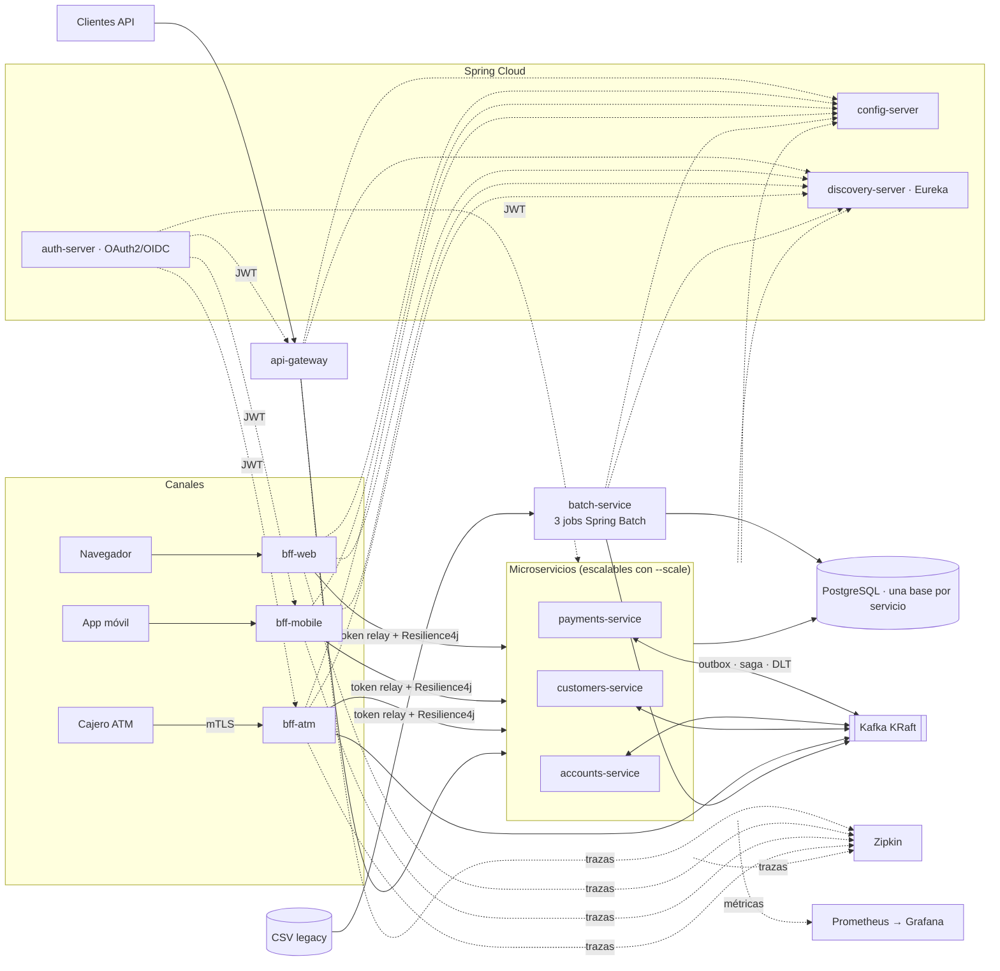

# Banco XYZ — Modernización Backend (Spring Cloud + Spring Batch)

**EFT — Desarrollo Backend III (PBY2203) · "Desarrollo Backend Avanzado: Spring Cloud y Batch"**

**Autora:** Guiselle Sepúlveda · **Docente:** Gabriel Grobier

Migración de los procesos del legacy de Banco XYZ (archivos CSV procesados por scripts/COBOL/Shell) a una plataforma de
**microservicios** con **Spring Cloud**, procesos **Spring Batch** paralelos y tolerantes a fallos, un **Backend for Frontend** por canal
(web, móvil y cajero), **seguridad distribuida con OAuth2** y **mensajería asíncrona con Kafka**. Todo corre localmente con
`docker compose up` y se despliega en una instancia EC2 con escalado horizontal de contenedores.


- **Instrucciones paso a paso (reproducible):** [instrucciones.md](instrucciones.md)
- **Despliegue en AWS (EC2 + arquitectura objetivo):** [despliegue.md](despliegue.md)
- **Informe técnico:** el informe técnico se entrega por separado.
- **Decisiones de arquitectura (ADR):** [docs/adr/](docs/adr/)

## Inicio rápido

```bash
scripts/init-env.sh                 # crea .env con secretos aleatorios y los certificados de desarrollo (certs/out)
docker compose up -d --build        # infraestructura + 11 aplicaciones; en ~1 min todos los contenedores quedan "healthy"
scripts/smoke-test.sh               # tokens por canal → flujo de negocio → 3 BFF → 3 jobs batch (≈ 77 verificaciones)
docker compose up -d --scale accounts-service=3 --scale payments-service=2 --scale customers-service=2   # escalado horizontal
```

Requisitos: Docker (Compose v2.24+), JDK 21 (solo para `keytool`), `curl`, `python3`, `openssl`, `jq`. Detalle y pruebas por componente en [instrucciones.md](instrucciones.md).

## Los 5 procesos clave de la migración (criterio C1)

| # | Proceso | Problema en el legacy | Solución | Componente implementado |
|---|---|---|---|---|
| 1 | **Migración batch a Spring Batch** | Scripts que leen CSV sin validación: un registro malo detiene todo o se pierde en silencio; sin reinicio ni paralelismo | 3 jobs con *skip* + *retry* con backoff, rechazados persistidos, partitioning local, step multi-hilo, restart desde el último chunk y reintento automático | [`batch/batch-service`](batch/batch-service) |
| 2 | **División del monolito en microservicios** | Un solo bloque: cualquier cambio exige redesplegar todo y no se puede escalar una parte | *Database per service*: clientes, cuentas y pagos independientes, con Config Server, Eureka y API Gateway | [`services/*`](services), [`infra/*`](infra) |
| 3 | **Patrón BFF** | Una misma API para navegador, móvil y cajero: sobre-extracción, seguridad mínima común | Un BFF por canal con datos, rendimiento y seguridad propios (sesión+cookie, tokens cortos+ETag/gzip, mTLS+Idempotency-Key) | [`bff/*`](bff) |
| 4 | **Seguridad distribuida (Spring Cloud Security / OAuth2)** | Credenciales compartidas y permisos a nivel de aplicación | Authorization Server propio (JWT), un cliente por canal con scopes distintos, resource servers en gateway y servicios, `@PreAuthorize` | [`infra/auth-server`](infra/auth-server), ADR-006/007 |
| 5 | **Mensajería asíncrona con Kafka** | Procesos acoplados por archivos y consultas síncronas; sin trazabilidad de eventos | 8 tópicos de 3 particiones, **Transactional Outbox**, **saga coreografiada** (débito → crédito → completado/compensación), consumidores idempotentes y DLT | `payments-service`, `accounts-service`, `libs/platform-common`, ADR-005 |

## Arquitectura



> Diagramas exportados a PNG en [`docs/diagramas/`](docs/diagramas/) (fuente Mermaid junto a cada imagen): arquitectura general, componentes por servicio,
> casos de uso, secuencia de la transferencia (saga + outbox), secuencia del retiro en el cajero, flujo de los jobs batch, despliegue en EC2,
> arquitectura AWS objetivo y legacy vs nuevo.

## Stack y versiones

| Capa | Tecnología y versión |
|---|---|
| Lenguaje / build | Java **21**, Maven multi-módulo (13 módulos) |
| Framework | Spring Boot **3.5.16** · Spring Cloud **2025.0.3** (Gateway 4.3.5, OpenFeign 4.3.3) · Spring Batch **5.2.6** · Spring Authorization Server **1.5.8** · Spring Kafka **3.3.16** |
| Resiliencia / docs | Resilience4j **2.2.0** · springdoc-openapi **2.8.17** |
| Datos y mensajería | PostgreSQL **16** (Flyway) · Apache Kafka **3.9.1** (modo KRaft) |
| Observabilidad | Micrometer Tracing + Zipkin **3.6** · Prometheus **v3.5.0** · Grafana **12.1.1** · logs JSON (logstash) con `traceId`/`spanId` |
| Contenedores | Docker + Compose, imágenes `eclipse-temurin:21-jre-alpine` (usuario no-root, `HEALTHCHECK`) |
| Pruebas | JUnit 5, Testcontainers (PostgreSQL, Kafka), MockWebServer — **283 pruebas** automatizadas |

La elección de versiones y el soporte OSS están justificados en [ADR-001](docs/adr/ADR-001-versiones-spring.md).

## Mapa de módulos y puertos

| Módulo | Rol | Puerto contenedor | Host (local) | Host (EC2) |
|---|---|---:|---:|---:|
| [`infra/config-server`](infra/config-server) | Spring Cloud Config (nativo, perfiles local/docker/aws) | 8888 | — | — |
| [`infra/discovery-server`](infra/discovery-server) | Eureka (dashboard) | 8761 | 8761 (127.0.0.1) | túnel SSH |
| [`infra/auth-server`](infra/auth-server) | OAuth2/OIDC: `web-client`, `mobile-client`, `atm-client`, `internal-service` | 9000 | 9000 | 9000 |
| [`infra/api-gateway`](infra/api-gateway) | Spring Cloud Gateway: `lb://`, JWT, rate limit, circuit breaker, retry, HTTPS | 8446 (gestión 18446) | 8446 | 443 |
| [`services/customers-service`](services/customers-service) | Clientes y perfil | 8081 | — | — |
| [`services/accounts-service`](services/accounts-service) | Cuentas, saldo y libro mayor | 8082 | — | — |
| [`services/payments-service`](services/payments-service) | Pagos, transferencias, depósitos, retiros (saga + outbox) | 8083 | — | — |
| [`bff/bff-web`](bff/bff-web) | BFF navegador: sesión + cookie, PKCE, CSRF | 8443 (gestión 18443) | 8443 | 8441 |
| [`bff/bff-mobile`](bff/bff-mobile) | BFF móvil: token corto, ETag, gzip, `fields=` | 8444 (gestión 18444) | 8444 | 8442 |
| [`bff/bff-atm`](bff/bff-atm) | BFF cajero: **mTLS**, PIN, límites, Idempotency-Key | 8445 (gestión 18445) | 8445 | 8443 |
| [`batch/batch-service`](batch/batch-service) | 3 jobs Spring Batch + API de lanzamiento | 8085 | — | — |
| [`libs/platform-common`](libs/platform-common) · [`libs/bff-common`](libs/bff-common) | Eventos, outbox, idempotencia, seguridad, errores · clientes Feign de los BFF | — | — | — |

Infraestructura (no son módulos Maven): PostgreSQL (5432), Kafka (9092/19092), Kafka UI (8089), Zipkin (9411), Prometheus (9090), Grafana (3000) — solo en `127.0.0.1`.
Los microservicios **no publican puertos** (se escalan con `--scale`); se alcanzan por el gateway o por los BFF.

## Estructura del repositorio

```
├── readme.md · instrucciones.md · despliegue.md       # entrega (nombres exactos)
├── docker-compose.yml · docker-compose.scale.yml · docker-compose.dev-ports.yml · .env.example
├── pom.xml                                            # parent multi-módulo
├── infra/        config-server · discovery-server · api-gateway · auth-server · config-repo (YAML que sirve el Config Server)
│                 prometheus · grafana · postgres · aws (EC2: scripts + override; target-architecture: ECS conceptual)
├── services/     customers-service · accounts-service · payments-service
├── bff/          bff-web · bff-mobile · bff-atm
├── batch/        batch-service
├── libs/         platform-common · bff-common
├── data/legacy/  CSV del legacy (movimientos, intereses, estados financieros)
├── certs/        generate-dev-certs.sh (CA propia, servidor, cajero ATM-0001, certificado ajeno)
├── scripts/      init-env.sh · token.sh · smoke-test.sh · e2e-flow.sh · bff-flow.sh · cross-channel-matrix.sh · scale-demo.sh · demo-resilience.sh
│                 batch-demo.sh · benchmark-batch.sh · run-local.sh · gen-dockerfiles.sh · analizar_datos_legacy.py · equivalencia_legacy.py · …
│                 (los scripts escriben sus logs en evidencias/, carpeta que no se versiona y se crea al ejecutarlos)
└── docs/         adr/ · openapi/ (contratos de los BFF) · postman/ · diagramas/ · analisis_datos_legacy.md · equivalencia_legacy.md
```

## Resultados destacados (medidos, no estimados)

- **Calidad de datos legacy:** [`docs/analisis_datos_legacy.md`](docs/analisis_datos_legacy.md) cuantifica los defectos por tipo; los jobs los aíslan en `batch_rejected_record` en vez de perderlos o detener el proceso.
- **Batch en paralelo** (500.000 filas, se reproduce con `scripts/benchmark-batch.sh`): `dailyTransactionReportJob` pasa de 58,5 s (1 partición) a 15,0 s (8 particiones), **3,9×**; `annualStatementJob` de 32,2 s a 7,9 s con 8 hilos, **4,1×**.
- **Equivalencia con el legacy:** cálculo independiente en Python vs. resultado del job, verificado por test ([docs/equivalencia_legacy.md](docs/equivalencia_legacy.md)).
- **BFF por canal** (`scripts/bff-flow.sh`): el mismo resumen de cuentas pesa 3.268 B sin BFF (5 llamadas), 2.373 B en web (1 llamada), 252 B en móvil y 96 B en el cajero.
- **Escalado horizontal** (`scripts/scale-demo.sh`): 3/2/2 réplicas en Eureka, reparto 10/10/10 por `X-Instance-Id` y **0 fallos** (30 GET + 10 POST) al matar una réplica sin aviso.
- **Smoke test** (`scripts/smoke-test.sh`): 77 verificaciones, 0 fallos, con el stack escalado.

## Pruebas automatizadas

```bash
mvn verify        # requiere Docker (Testcontainers): *Test = unitarias, *IT = integración (PostgreSQL y Kafka reales)
```

| Módulo | Pruebas | | Módulo | Pruebas |
|---|---:|---|---|---:|
| batch-service | 78 | | bff-web | 28 |
| accounts-service | 27 | | bff-mobile | 24 |
| payments-service | 26 | | bff-atm | 33 |
| customers-service | 20 | | api-gateway | 16 |
| platform-common | 12 | | auth-server | 12 |
| config-server | 4 | | discovery-server | 3 |

## Despliegue en AWS

Desplegado el 2026-10-11 en una instancia **EC2 `r6i.large` (2 vCPU y 16 GiB, us-east-1a) de AWS Academy Learner Lab con Docker Compose** y escalado horizontal 3/2/2 de los microservicios, con IP elástica `34.207.23.142` (la instancia se elimina al terminar la entrega, por lo que esa IP deja de responder). El *smoke test* remoto desde el portátil, contra la IP pública y validando el certificado, terminó con 77 verificaciones correctas; las capturas de esa ejecución están en el informe técnico. Pasos, Security Group, presupuesto de memoria, verificación remota (`scripts/smoke-test.sh --host`),
costos y limpieza en [despliegue.md](despliegue.md); la arquitectura productiva (ECS Fargate + ALB + RDS + MSK) está documentada como objetivo.

#